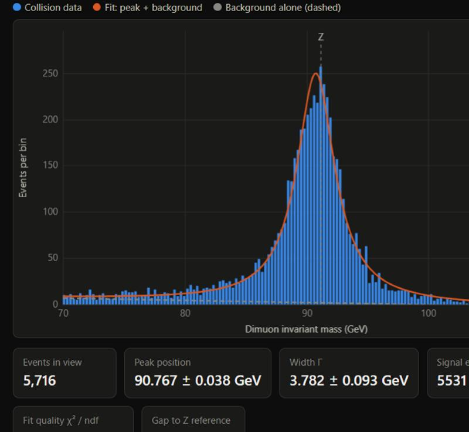
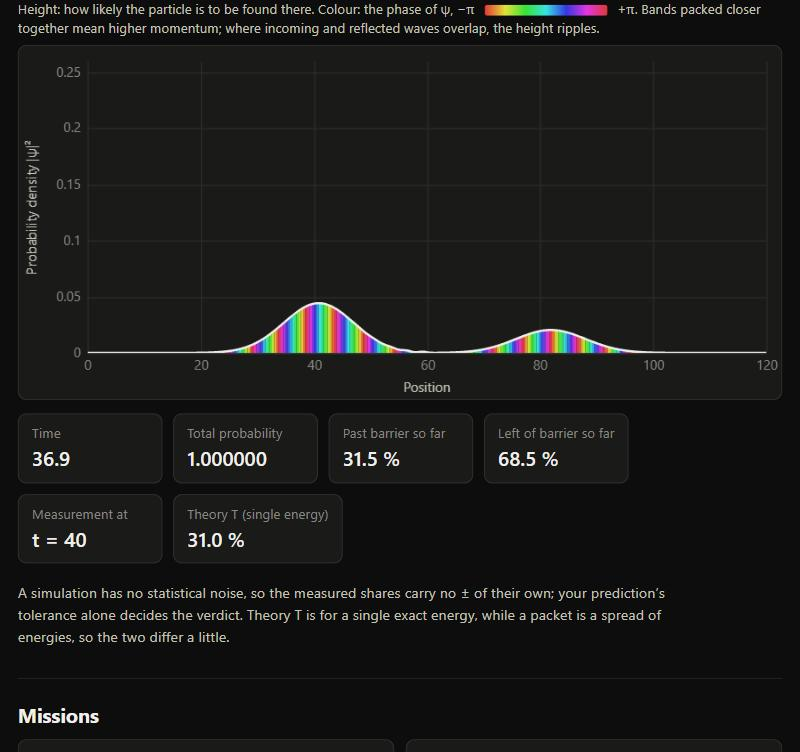
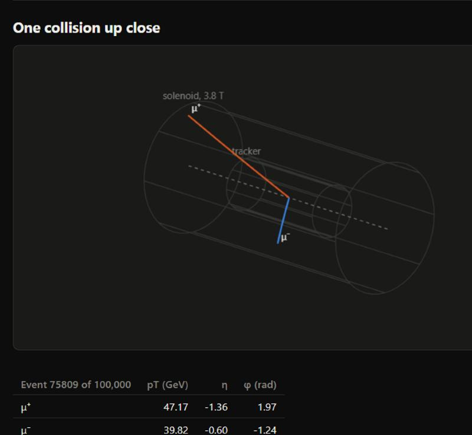

# PhysLab

[](https://github.com/Adecodes-dot/physlab/actions/workflows/ci.yml)

**A physics laboratory in the browser: real CERN and NASA data, simulations you can break on purpose, and the working method of research built in.**

**Live: https://adecodes-dot.github.io/physlab/**

PhysLab is for anyone who wants to do physics instead of reading about it, from a first look at a particle peak to checking a published number against data. You make a prediction, the lab measures the answer with an uncertainty, and the notebook records whether your idea survived.



## What you can do

| Lab | Field | What it measures | Source |
|---|---|---|---|
| Dimuon mass spectrum | Particle physics | Mass, width and signal yield of the J/ψ, ψ(2S), Υ and Z peaks in 100,000 real collisions, with a rotatable 3D event display | CMS open data |
| Exoplanet census | Astrophysics | Power-law fits across 6,470 confirmed planets, including Kepler's third law | NASA Exoplanet Archive |
| Gravity sandbox | Astrophysics | Orbital periods and energy drift in an N-body simulation with two integrators | Simulation |
| Wave packet and barrier | Quantum physics | Transmitted and reflected shares of a wave packet, coloured by the phase of ψ | Simulation |
| Nerve impulse | Biophysics | Firing rate of a Hodgkin–Huxley neuron under current and channel block | Simulation |
| Data bench | Your data | Histogram-and-peak or scatter-and-line fits on any CSV file, read locally | Your file |

Every lab shares three tools:

- **Measurements with uncertainties.** A peak fit, a line fit, a timed orbit: each reports a value, its error and a quality measure. A bump must stand 3σ above the background before it is called a peak.
- **A lab notebook that enforces the scientific method.** You lock a numerical prediction before the result is shown. The notebook compares the two, records the verdict with the exact settings used, flags a record if the settings changed after locking, and can cite the paper (arXiv id or DOI) a prediction came from.
- **Missions at three levels.** Fifteen investigations, from "find the J/ψ" to "find where the textbook tunnelling formula fails". A mission is passed by producing the measurement, not by answering a quiz.



## Evidence that the numbers are right

`npm run validate` measures known quantities with the same code the labs run and compares each with an independent reference. It runs in CI on every push, and a failure turns the build red. The in-app [validation report](https://adecodes-dot.github.io/physlab/#validation) shows the latest run.

| Check | Result | Reference |
|---|---|---|
| Invariant mass, all 100,000 events | within 0.0006 GeV of every value CMS published | CMS mass column |
| J/ψ, ψ(2S), Υ(1S), Z masses | all within 0.5 % | Particle Data Group |
| Fit error bars | pull spread 1.02 over 400 simulated experiments | 1.00 means honest errors |
| Kepler exponent from 5,623 planets | 0.675 | 2/3 |
| Orbit integrator convergence order | 2.000 | 2 for leapfrog |
| Energy conservation, 10 orbits | 4 parts in 10¹⁰ | exact conservation |
| Quantum probability after scattering | 1 to 9 decimal places | exact conservation |
| Tunnelling probability | 31.5 % | 31.0 % analytic |

In total: **17 of 17 physics benchmarks and 16 of 16 unit tests pass.**

### A bug the validation suite caught

The first version computed each mass from the transverse momentum, pseudorapidity and azimuth columns of the CMS file. Checking every event against the mass CMS itself published showed that about 5 % disagreed, some by tens of GeV. The cause is in the source file: for those events its `pt`/`eta`/`phi` columns do not match its own `px`/`py`/`pz`. PhysLab now uses the Cartesian momenta, and the largest difference from CMS across all 100,000 events is 0.0006 GeV. The check is part of the suite, so the problem cannot return unnoticed.

## Engineering

| | |
|---|---|
| Runtime dependencies | 0 |
| Build step | none: plain HTML, CSS and JavaScript modules |
| Application code | about 1,550 lines of JavaScript, 43 kB gzipped including HTML and CSS |
| Tests | 16 unit tests and 17 physics benchmarks, run by GitHub Actions |
| Hosting | static files on GitHub Pages |
| Accessibility | labelled controls and charts, light and dark themes, series colours from a palette checked for colour-vision deficiency. Drag-to-fit needs a mouse or touch. |

```
index.html, style.css
src/
  main.js        routing and page list
  kit.js         controls, stat tiles, canvas plotting, tooltips
  notebook.js    predictions, verdicts, records, missions panel
  missions.js    the fifteen missions and their pass checks
  pages.js       overview, validation report, cross-lab notebook
  table.js       CSV parsing for the data bench
  physics/       pure functions: kinematics, fitting, N-body, Schrödinger, neuron
  labs/          one file per laboratory
tools/
  fetch-data.mjs refreshes data/ and cross-checks every mass against CMS
  validate.mjs   the physics benchmark suite
test/            unit tests (node:test)
```

Design choices worth knowing:

- **Physics is separated from the interface.** Everything under `src/physics/` is a pure function with no access to the page, so the same code runs in the browser, in the tests and in the validation suite.
- **A lab is one file with one contract.** Each exports `{ id, field, title, blurb, mount(root) }` and hands the notebook four functions: `results`, `method`, `restore` and `blind`. Adding the notebook and missions to a new lab is one call.
- **Colour carries meaning.** Hue in the quantum lab is the phase of the wave function; track colour in the event display is electric charge; series colours come from a palette validated for colour-vision deficiency in both themes.
- **Data is bundled deliberately.** CERN and NASA do not allow direct requests from a web page, so trimmed snapshots live in `data/` and one script refreshes them.



## Run it

Needs [Node.js](https://nodejs.org) 20.11 or newer. There is nothing to install.

```bash
npm start
```

Then open http://localhost:5200. Any static file server works too.

```bash
npm test
```

```bash
npm run validate
```

```bash
npm run data
```

`npm run data` downloads fresh copies of both datasets and repeats the mass cross-check.

## Data and credits

- **`data/dimuon.csv`**: CMS collaboration, *Dimuon events from Run2011A*, [CERN Open Data record 545](https://opendata.cern.ch/record/545), released under CC0. This is an education and outreach subset. It is not suitable for a physics result.
- **`data/exoplanets.json`**: [NASA Exoplanet Archive](https://exoplanetarchive.ipac.caltech.edu/), Planetary Systems Composite Parameters table. This research has made use of the NASA Exoplanet Archive, which is operated by the California Institute of Technology, under contract with the National Aeronautics and Space Administration under the Exoplanet Exploration Program.
- Reference particle masses: Particle Data Group. Neuron model: Hodgkin and Huxley, *J. Physiol.* 117 (1952). Three-body figure-eight: Chenciner and Montgomery (2000).

PhysLab is an independent project. It is not affiliated with or endorsed by CERN, the CMS collaboration or NASA.

## Limits

- This is a learning and exploration tool on small open datasets. It is not a substitute for the full analysis software and data volumes used in experimental collaborations.
- Fit uncertainties are statistical only. Detector calibration and peak-shape effects are not modelled, which is why the collider masses sit a little below their references.
- The simulations use simplified setups: planar circular starting orbits, one spatial dimension for the quantum lab, a single-compartment neuron.
- Notebook records and mission progress stay in one browser. There is no account, sync or import.
- The CSV reader does not handle quoted fields that contain the delimiter.

## Roadmap

- Gravitational-wave lab on LIGO open strain data
- Parameter scans that produce a curve, such as transmission against energy
- User-defined force laws and potentials
- Systematic uncertainties in the collider fits

## Licence

Code: MIT, see `LICENSE`. Data: see the sources above.
